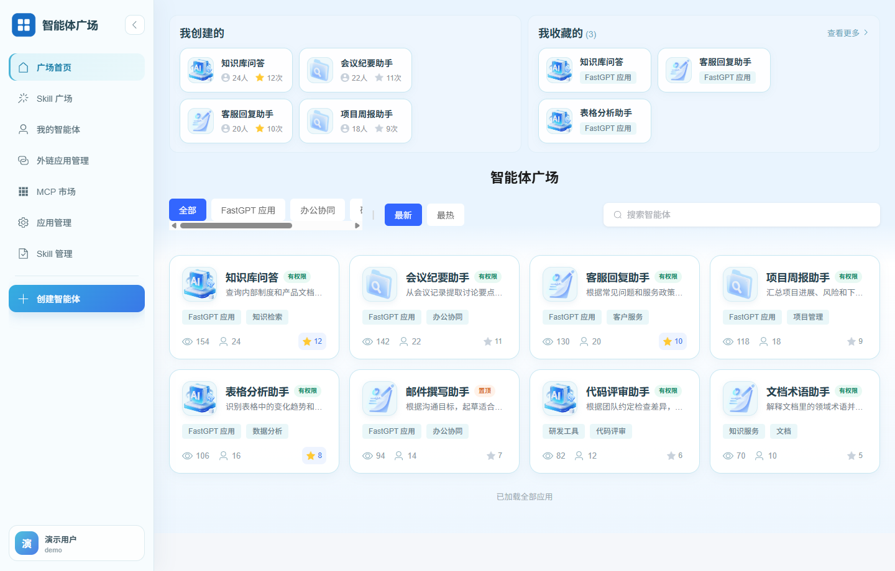
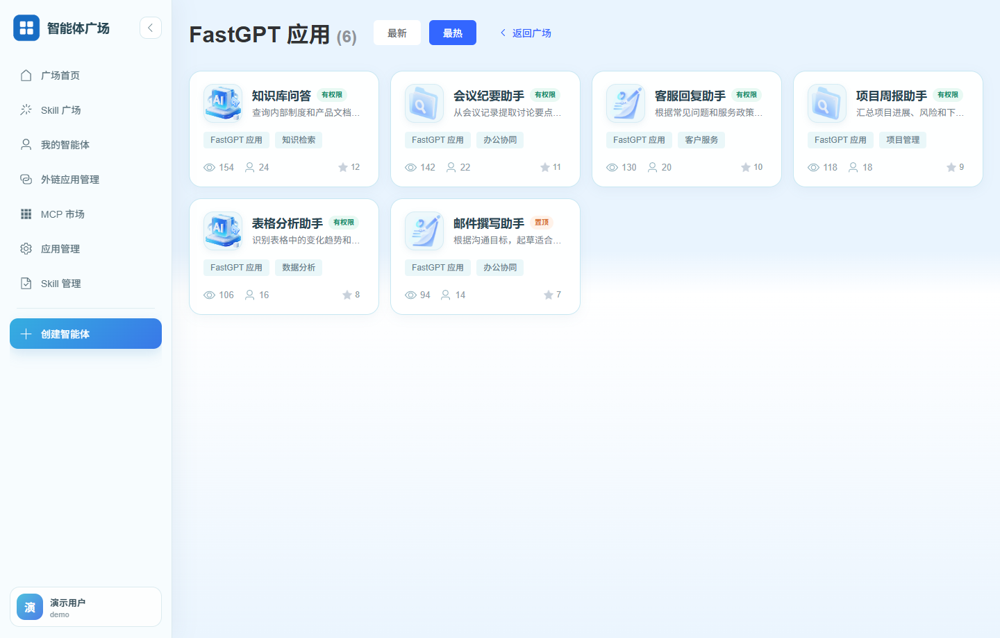
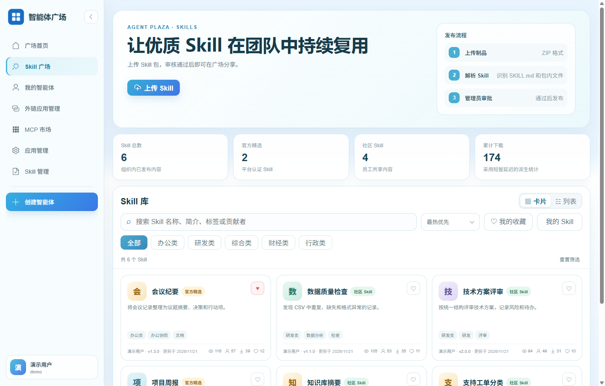
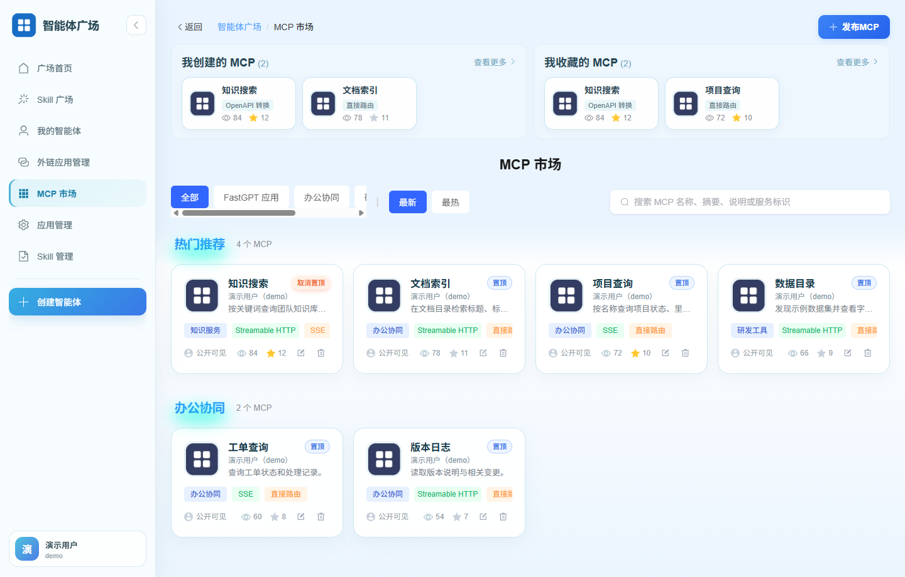

# Agent Plaza

Agent Plaza 是一个自托管的智能体、MCP 服务和 Skill 目录。应用广场读取 FastGPT 的应用及相关权限数据，也支持管理链接应用。MCP 市场通过 Higress 发布和路由服务。Skill 市场支持 ZIP 提交、异步解析、审核、发布和下载。

## 部署入口

| 使用范围 | 先准备 | 逐步接入手册 |
| --- | --- | --- |
| 应用广场和 FastGPT 应用 | 已运行的 FastGPT，Agent Plaza 后端可达的 FastGPT MongoDB 地址及专用账号 | [FastGPT 与 MongoDB](docs/dependencies/fastgpt/README.md) |
| MCP 市场 | Higress 控制面 API、数据面网关和对应授权 | [Higress 与 MCP](docs/dependencies/higress/README.md) |
| Skill 市场 | 私有 S3 兼容存储桶，以及运行 Skill 解析 Worker 的资源 | [Skill OSS 与解析 Worker](docs/dependencies/skill-oss/README.md) |
| 公共基础设施 | IdTrust 兼容身份源、Redis。正式站点还需域名及 TLS | [Docker Compose / Kubernetes 部署总览](docs/DEPLOYMENT.md) |

Docker Compose 部署 Agent Plaza 前后端和 Redis，按需启用 Skill Worker。Kubernetes 使用客户提供的 FastGPT MongoDB 和 Redis。给客户交付时可从部署总览开始，再按启用范围阅读对应手册。

## 界面预览

截图来自客户版，使用演示数据。

| 广场首页 | FastGPT 应用列表 |
| --- | --- |
|  |  |

| Skill 市场 | MCP 市场 |
| --- | --- |
|  |  |
